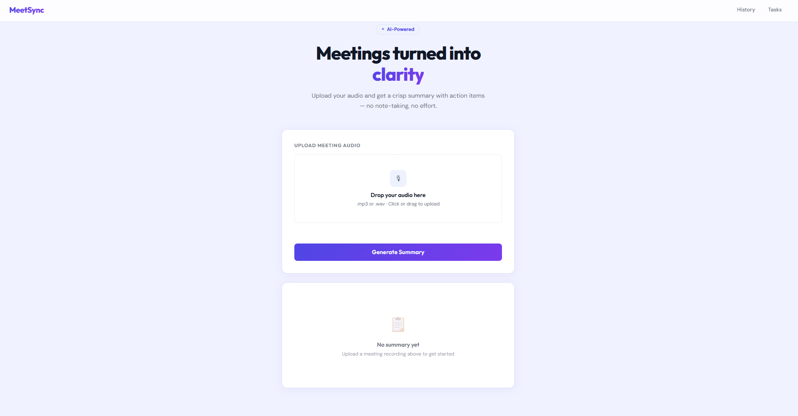
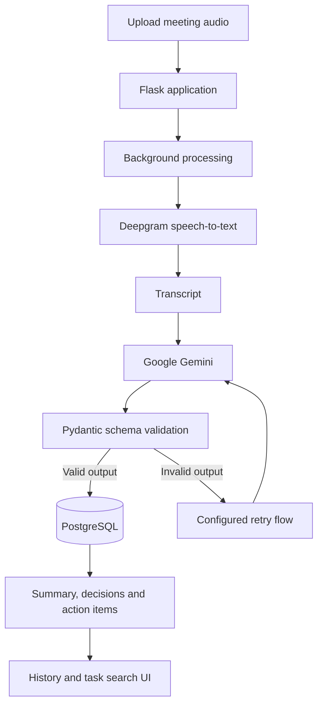

<div align="center">

# ConveneIQ
### Turn conversations into clear decisions and actionable work.

AI-powered meeting intelligence that transforms recordings into structured minutes, decisions, and action items.

<p>
  
  
  
  
  
</p>

<p>
  
</p>

*Less time writing meeting notes. More time acting on what matters.*

</div>

---

## ✨ Overview

Meetings generate ideas, decisions, and commitments—but those details can get lost in long recordings or scattered notes.

**ConveneIQ** turns meeting audio into structured, searchable meeting minutes. It combines speech-to-text transcription with an LLM pipeline, validates the generated structure, and stores results so users can revisit decisions and follow up on tasks.

<div align="center">

**🎙️ Audio → 📝 Transcript → 🧠 AI minutes → ✅ Decisions & tasks**

</div>

## 🚀 Features

<table>
<tr>
<td width="50%" valign="top">

### 🎙️ Audio transcription
Upload WAV or MP3 recordings and convert speech to text with Deepgram.

</td>
<td width="50%" valign="top">

### 🧠 AI-generated minutes
Use Google Gemini to produce a structured summary and capture key decisions.

</td>
</tr>
<tr>
<td width="50%" valign="top">

### ✅ Action-item extraction
Extract task fields such as owner, deadline, priority, and dependencies.

</td>
<td width="50%" valign="top">

### 🛡️ Structured-output validation
Validate generated content against a Pydantic schema before accepting it.

</td>
</tr>
<tr>
<td width="50%" valign="top">

### ⚙️ Asynchronous processing
Keep uploads responsive while transcription and summarization run in the background.

</td>
<td width="50%" valign="top">

### 🔎 History and task search
Review past meetings, check processing status, and search tasks across meetings.

</td>
</tr>
</table>

## 🧭 How it works



1. **Upload** — Flask creates a meeting record and starts background processing.
2. **Transcribe** — Deepgram converts the recording into text.
3. **Generate** — Gemini turns the transcript into structured minutes and task details.
4. **Validate** — Pydantic checks that the response matches the expected schema; invalid output follows the configured retry path.
5. **Store** — meeting results and extracted tasks are saved to PostgreSQL.
6. **Review** — users can view results, revisit meeting history, and search tasks.

## 🧰 Technology stack

| Layer | Technology | Purpose |
|---|---|---|
| Backend | Python, Flask | Routes, uploads, status checks, application logic |
| Speech-to-text | Deepgram API | Audio transcription |
| Generative AI | Google Gemini 2.5 Flash | Summaries, decisions, action-item extraction |
| Output validation | Pydantic | Validates the expected output structure |
| Database | PostgreSQL, SQLAlchemy, Neon | Stores meetings, transcripts, tasks, and metrics |
| Background jobs | Celery + Redis for evaluation; Python threading in the deployed demo | Runs longer tasks outside the upload request |
| Frontend | HTML, CSS, JavaScript | Upload, status, results, history, and task search |
| Load testing | Locust | Controlled concurrent-load experiments |
| Scheduling | APScheduler | Periodic maintenance checks |
| Hosting | Render | Demo deployment |

## 📊 Engineering and evaluation

The application records processing metrics so its behaviour can be inspected instead of judging it only by whether an AI response looks plausible.

<details>
<summary><strong>Documented load-test results</strong></summary>

The existing project documentation describes a controlled burst test with **10 simultaneous uploads**, approximately one-minute audio files, and **mocked LLM latency of about three seconds**. A Celery worker was tested with different concurrency settings.

| Worker concurrency | Average queue delay | Average processing time | Average total time |
|---:|---:|---:|---:|
| 1 | ~24.7 s | ~5.3 s | ~30.0 s |
| 2 | ~14.3 s | ~6.6 s | ~20.9 s |
| 4 | ~5.9 s | ~6.3 s | ~12.2 s |

**Observation:** Higher concurrency reduced average queue delay in this test, while average processing time remained relatively similar. Because LLM latency was mocked, these results describe the documented experiment—not guaranteed production performance.

</details>

<details>
<summary><strong>Metrics and SQL examples</strong></summary>

Recorded metrics include:

- `processing_time_seconds` — processing duration
- `transcript_word_count` — transcript size sent to the LLM
- `gemini_retry_count` — number of retries
- `status` — success or failure
- `failure_reason` — recorded failure details
- `queue_delay_seconds` — time waiting before a worker picks up a job

```sql
-- Average processing time for successful meetings
SELECT ROUND(AVG(processing_time_seconds)::numeric, 2) AS avg_seconds
FROM meeting_metrics
WHERE status = 'success';

-- Meetings that required Gemini retries
SELECT meeting_id, gemini_retry_count
FROM meeting_metrics
WHERE gemini_retry_count > 0;

-- Count records by status
SELECT status, COUNT(*)
FROM meeting_metrics
GROUP BY status;
```

The results above come from the existing project documentation and should be reproduced before being presented as independently verified results.

</details>

## 🏗️ Key design decisions

<details>
<summary><strong>Why asynchronous processing?</strong></summary>

Transcription and summarization can take longer than a normal web request. Background processing allows the upload request to finish promptly while the browser checks the job status separately.
</details>

<details>
<summary><strong>Why validate LLM output?</strong></summary>

LLM responses may be malformed or omit expected fields. Pydantic checks the structure expected by downstream code, and invalid output can follow a retry path. **Schema validation does not guarantee factual correctness**; generated summaries and extracted tasks still need quality evaluation.
</details>

<details>
<summary><strong>Why does the deployed demo use threads?</strong></summary>

The existing documentation explains that running the web server and a Celery worker together exceeded the memory limit of the selected free hosting setup. The deployed demo therefore uses Python threading, while Celery + Redis is used for evaluation and load testing.

Threads are not equivalent to a durable queue: in-flight work may be lost during a process restart, and this approach is not intended for large-scale production use.
</details>

<details>
<summary><strong>What does session isolation mean?</strong></summary>

Meeting records are filtered using a browser-session identifier. This helps separate records in the demo, but it is not a replacement for full authentication and authorization.
</details>

## 💻 Run locally

### Prerequisites

- Python
- Deepgram API credentials
- Google Gemini API credentials
- Access to a PostgreSQL database

### 1. Clone the repository

```bash
git clone <YOUR_REPOSITORY_URL>
cd <YOUR_PROJECT_DIRECTORY>
```

### 2. Create and activate a virtual environment

```bash
python -m venv venv
```

**Windows PowerShell**
```powershell
.\venv\Scripts\Activate.ps1
```

**macOS / Linux**
```bash
source venv/bin/activate
```

### 3. Install dependencies

```bash
pip install -r requirements.txt
```

### 4. Configure environment variables

Create a `.env` file in the project root:

```dotenv
GEMINI_API_KEY=your_gemini_api_key
DEEPGRAM_API_KEY=your_deepgram_api_key
FLASK_SECRET_KEY=replace_with_a_random_secret
DATABASE_URL=your_postgresql_connection_url
```

Use your own credentials. Never commit `.env` files, API keys, or database passwords to version control.

### 5. Initialize the database and run the application

```bash
python -m database.init_db
python app.py
```

Open the local URL printed in the terminal. Verify the exact setup requirements against the current repository and `requirements.txt`.

## ⚠️ Limitations

- **No speaker diarization:** attribution depends on what is clear in the transcript and explicit speaker references.
- **Audio quality:** background noise and overlapping speech can reduce transcription quality.
- **Ambiguous tasks:** unclear ownership may result in an `Unassigned` owner.
- **Vague deadlines:** phrases such as “soon” may not resolve to a concrete date.
- **External API dependency:** service outages and rate limits can interrupt processing.
- **Thread-based deployment:** the deployed approach lacks the durability and independent scaling of a dedicated queue.
- **Session-based isolation:** this is not a full authentication system.

## 🔭 Potential improvements

- Add speaker diarization to improve speaker attribution.
- Build a labelled evaluation set to measure summary and task-extraction quality.
- Add automated tests for malformed LLM responses, API timeouts, retries, and failed jobs.
- Add authentication and authorization before handling sensitive multi-user meeting data.
- Use durable object storage and dedicated workers for a larger deployment.
- Let users review and correct extracted tasks before saving or sharing them.

*These are potential future improvements, not features claimed to be implemented.*

## 📁 Project structure

```text
ConveneIQ/
├── app.py
├── summarizer.py
├── transcribe.py
├── tasks.py
├── check_models.py
├── database/
│   ├── connection.py
│   ├── models.py
│   └── init_db.py
├── utils/
│   ├── metrics.py
│   ├── stale_job_detector.py
│   └── db_safe_commit.py
├── templates/
├── assets/
├── requirements.txt
└── README.md
```

## 🎬 Demo and screenshots

Make sure the screenshot paths and demo URL below exist in this repository and are current.

- **Application:** `assets/meetsync_main_page.png`
- **Meeting results:** `assets/meetsync_summary.png`
- **Architecture:** `assets/meetsync_architecture.png`

## 📄 License

See the repository's [`LICENSE`](LICENSE) file for license details.

---

<div align="center">

**ConveneIQ · From spoken conversations to structured outcomes.**

</div>
